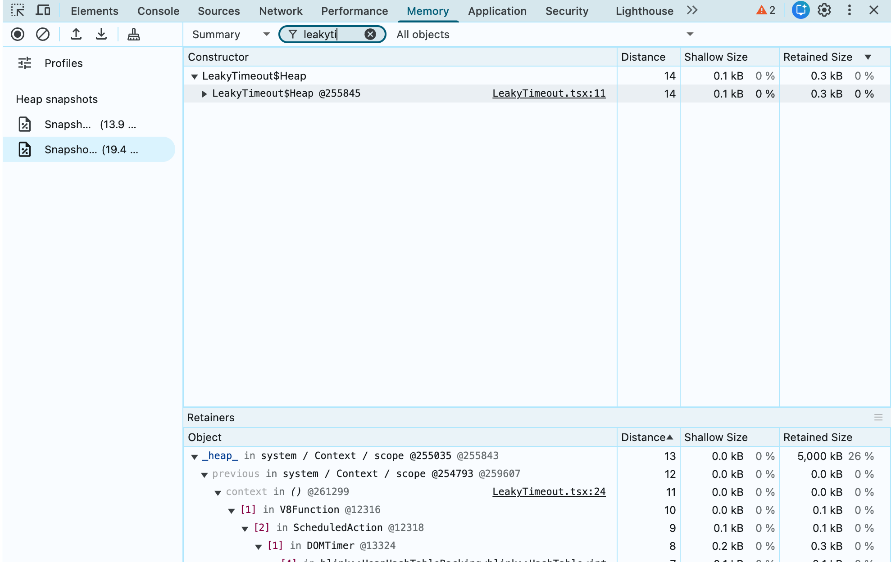

# react-memory-leak-detector

Spot React memory leaks while you develop — no heap snapshot needed to find out
*that* something leaked.

When a component unmounts but something still holds onto it (a stray timer,
listener, subscription, or closure), you get a **console warning** about 10
seconds later and a **leak event** you can forward to your own logger or Sentry.
Warnings are *suspected* leaks: a component that was cleaned up correctly is
reported too if the browser hasn't garbage-collected it yet. Forcing a
garbage collection tells the two apart (see
[Confirming a leak](#confirming-a-leak)). Dev-only — it compiles out of
production builds.

## Install

```bash
npm install --save-dev react-memory-leak-detector
```

## Setup

Two steps: add the build plugin, then import the runtime once in dev.

### 1. Add the plugin

**Vite**

```ts
// vite.config.ts
import { defineConfig } from "vite";
import react from "@vitejs/plugin-react";
import heapMarkers from "react-memory-leak-detector/vite";

export default defineConfig({
  plugins: [
    heapMarkers(), // list it BEFORE react()
    react(),
  ],
});
```

Dev-only by default, so nothing ships to production. Works with any
`@vitejs/plugin-react` version (or none). Keep `heapMarkers()` before `react()` —
it warns you at startup if the order is wrong.

**Next.js** — wrap your config:

```ts
// next.config.ts (or next.config.mjs)
import withHeapMarkers from "react-memory-leak-detector/next";

const nextConfig = {
  /* your config */
};

export default withHeapMarkers(nextConfig);
```

No `.babelrc` needed, so Next keeps compiling with SWC (and `next/font` keeps
working). Only the development browser bundle is instrumented: production builds
and React Server Components are left untouched. Works with webpack and
Turbopack. On Next 15.x, Turbopack only instruments files marked `"use client"`.
Turbopack on Next 15.2 and earlier isn't supported; use webpack (`next dev`
without `--turbopack`).

**Webpack / Babel** — add the plugin to your Babel config, in development:

```json
// .babelrc
{ "env": { "development": { "plugins": ["react-memory-leak-detector/babel-plugin"] } } }
```

In a Next.js app, use the wrapper above instead. A `.babelrc` replaces Next's
compiler setup: without `"presets": ["next/babel"]` nothing compiles, and under
webpack it turns off SWC, which breaks `next/font`. If you already use Babel
with Next, add the preset and, for the App Router,
`["react-memory-leak-detector/babel-plugin", { "skipServerComponents": true }]`.

### 2. Import the runtime

Load it once at the top of your app entry, in dev only:

```js
// Vite: your entry file, e.g. src/main.tsx
if (import.meta.env.DEV) import("react-memory-leak-detector/runtime");

// Webpack: your entry file
if (process.env.NODE_ENV === "development") import("react-memory-leak-detector/runtime");
```

**Next.js** — the runtime must load in the browser. With Next 15.3+, put it in
`instrumentation-client.ts` at the project root (next to `app/` or `pages/`):

```ts
// instrumentation-client.ts
if (process.env.NODE_ENV === "development") import("react-memory-leak-detector/runtime");
```

On older versions, use the same line in `pages/_app.tsx` (Pages Router) or at the
top of a `"use client"` component rendered by your root layout (App Router).
Don't put it in `app/layout.tsx` itself: that's a Server Component, so the
import never reaches the browser.

That's it. Type declarations are bundled, so TypeScript needs no extra setup.

The dynamic `import()` resolves after React's first render, so the app shell and
whatever else is in the initial tree render before the tracker exists. That's
fine: the runtime adopts any component it first sees at mount or unmount, so
those components are tracked and their leaks reported like any other. To call
the tracker API from your entry file (e.g. `subscribe`), wait for the import:

```js
if (import.meta.env.DEV) {
  import("react-memory-leak-detector/runtime").then(() => {
    window.__heapTracker?.subscribe((event) => console.log("leak", event));
  });
}
```

## Getting leaks

On page load the tracker installs. Suspected leaks show up as console warnings
about `leakAgeMs` (10 s by default) after the component unmounts:

```
[heap-leak] Suspected leak: UserCard — 1 instance(s) unmounted >10s ago still retained (live 1 total)
```

Any time, run `window.__heapTracker.report()` for a live table of tracked
components. Two numbers matter:

- **live** — instances still in memory (mounted, or unmounted and not yet collected).
- **stale** — unmounted more than `leakAgeMs` ago and *still* in memory. Stale
  means *suspected*: either something is holding the component (a leak), or the
  garbage collector hasn't run since it unmounted. See
  [Confirming a leak](#confirming-a-leak).

Prefer to handle leaks yourself — a debug overlay, your logger, Sentry? Subscribe:

```ts
const unsubscribe = window.__heapTracker?.subscribe((event) => {
  // { component, stale, live, leakAgeMs, at }
  Sentry.captureMessage(`heap-leak:${event.component}`, { extra: event });
});
```

Events fire only for stale components and are debounced per component. Like the
warnings, they are suspected leaks, so some of what you forward will be
garbage-collection lag rather than leaks. The global
is typed as optional (it only exists once the runtime import has resolved), so
subscribe from the import's `.then()` or anywhere after it — not on the line
right after a fire-and-forget `import()`.
`configure({ logging: false })` keeps the events but silences the console.

## Confirming a leak

The tracker can only see that an unmounted component is *still in memory*, not
why. The browser frees memory only when its garbage collector runs, and an
idle tab may not run it for a while, so a component that was cleaned up
correctly can outlive `leakAgeMs` and be reported too. Raising `leakAgeMs` makes
that less likely but doesn't rule it out.

To tell the two apart, force a garbage collection, then look again:

1. In Chrome DevTools → **Memory**, click **Collect garbage** (the trash-can
   icon).
2. Run `window.__heapTracker.report()`.

Components still **stale** after a collection are really being held: that's
your leak. Components that dropped out were only waiting to be collected.

From code (a debug overlay, an automated test), start Chrome with
`--js-flags="--expose-gc"` and call `window.__heapTracker.forceGc()`, which
collects and re-sweeps in one step.

## Finding the cause

A stale component that survives a garbage collection tells you *what* leaked; a
heap snapshot tells you *why*. In
Chrome DevTools → Memory, take a snapshot and filter for `ComponentName$Heap`:



Each row is a leaked instance. Select one and read the **Retainers** panel
bottom-up to see what's holding it — here a `DOMTimer`, i.e. an uncleared
`setTimeout`/`setInterval`. Clean it up on unmount and the instances disappear.

## Configuration

All options are optional. The common ones, passed to the plugin:

```ts
heapMarkers({
  leakAgeMs: 10000,   // ms unmounted-but-retained before it's reported
  logging: true,      // console warnings on/off
  trackHooks: true,   // also track custom hooks, not just components
  excludeNames: [/^useTranslation$/], // component/hook names to skip entirely
});
```

With Next.js, pass the same options as the second argument:
`withHeapMarkers(nextConfig, { leakAgeMs: 5000 })`.

Runtime options can also be changed live:
`window.__heapTracker.configure({ leakAgeMs: 5000 })`.

## Compatibility

| React feature                                              | Status                                                                              |
| ---------------------------------------------------------- | ----------------------------------------------------------------------------------- |
| React 17 / 18 / 19 function components & hooks             | ✅ (React 17 root unmounts: see below)                                               |
| Concurrent rendering, Suspense, StrictMode (React 18 / 19) | ✅                                                                                   |
| SSR (effects no-op server-side)                            | ✅                                                                                   |
| React Compiler (1.0)                                       | ✅ compiled as usual; see below                                                      |
| `<Activity mode="hidden">` (React 19.2+)                   | ⚠️ hidden components are reported as leaks; see below                               |
| React Server Components                                    | ✅ skipped by the Next.js wrapper; ⚠️ Babel plugin: use `skipServerComponents: true` |
| Class components                                           | ❌ not instrumented (PRs welcome)                                                    |

**React Compiler.** Instrumented components and hooks compile as usual. The
compiler normally moves closures that use nothing from the component (an empty
event handler, say) out to module scope. With the Vite plugin and the Next.js
wrapper, the instrumentation runs first and keeps such closures in the
component, so a missing cleanup is still reported. With the Babel plugin in the
same Babel config as the compiler, the compiler runs first: those closures stay
hoisted, no longer hold the component, and aren't reported.

**React 17: unmounting a whole root.** After `ReactDOM.unmountComponentAtNode`,
React 17 can keep that root's last tree in memory until it next renders
something (seen under StrictMode and after a Suspense retry). Its components
are then reported even though they cleaned up, and a forced garbage collection
doesn't clear them; any later React render does. Components removed from an
app that stays mounted, the normal case, aren't affected, and neither is
React 18+.

**`<Activity mode="hidden">`.** Hiding runs a component's effect cleanups but
keeps it in memory, which looks exactly like a leak: once hidden for longer than
`leakAgeMs`, it's reported, and that clears when it's shown again. List such
components in `excludeUnmountTracking` to stop this. They stay searchable in
heap snapshots, but are never reported, leaked or not.

<details>
<summary>Advanced — all options, API, engines, and how it works</summary>

### All plugin options

```ts
heapMarkers({
  // ── build-time: what gets instrumented ──
  include: /\.[tj]sx?$/,              // files to process
  excludeNames: [/^useTranslation$/], // names that skip ALL instrumentation
  excludeUnmountTracking: [],         // names that keep the heap marker but skip
                                      //   the unmount effect — use for components
                                      //   under <Activity mode="hidden">, whose
                                      //   cleanup fires while still alive
  trackHooks: true,                   // false = components only
  skipServerComponents: false,        // true = skip files without "use client" (RSC)

  // ── runtime: how leaks are judged/reported (injected into the app) ──
  logging: true,                      // false = track silently, no console warnings
  leakAgeMs: 10000,                   // age before an unmounted instance is "stale"
  suspectThreshold: 1,                // min stale instances before warning/event
  sweepIntervalMs: 2000,              // how often the sweep runs
  warnCooldownMs: 30000,              // min gap between warnings for the same component
});
```

Runtime options can also be set before load (`window.__heapTrackerOptions = { … }`,
e.g. at the top of `main.tsx`) or live (`window.__heapTracker.configure({ … })`).

### `window.__heapTracker` API

| Call | Purpose |
| ---- | ------- |
| `report()` | `console.table` of every component with live instances; also returns the array. |
| `subscribe(fn)` | Listen for stale-leak events; returns an unsubscribe function. |
| `configure(opts)` | Update runtime options (e.g. `{ logging: false }`). |
| `sweep()` | Force an immediate sweep (otherwise every `sweepIntervalMs`). |
| `forceGc()` | `window.gc?.()` + re-sweep. Needs Chrome started with `--js-flags="--expose-gc"`; use it to rule out plain GC lag. |

Leak event shape: `{ component, stale, live, leakAgeMs, at }`. `component` matches
the `ComponentName$Heap` marker in heap snapshots.

### Engines (Vite plugin and Next.js wrapper)

The Vite plugin and the Next.js wrapper inject markers with **Oxc** by default
and fall back to **Babel** automatically if `oxc-parser` can't load — you
normally don't touch this. `oxc-parser` is an optional dependency that needs
Node ^20.19 or >=22.12; the Babel fallback needs `@babel/core` installed
(Next.js apps often don't have it). If neither works, you get one error
explaining both. Force one with `heapMarkers({ engine: "oxc" })` or `"babel"`. The Babel
engine parses with Babel and reads no project config, so non-default syntax
(decorators, `using`, import attributes) needs its parser opted in, e.g.
`heapMarkers({ engine: "babel", parserPlugins: ["decorators-legacy"] })`; the Oxc
engine parses these natively. `oxc-parser` needs Node ^20.19 or >=22.12.

TypeScript option types are exported as `HeapMarkersOptions`
(`/babel-plugin`), `HeapMarkersViteOptions` (`/vite`) and
`HeapMarkersNextOptions` (`/next`).

### How it works

1. The plugin tags every component/hook with a uniquely-named marker —
   searchable as `ComponentName$Heap` in heap snapshots — and injects a synthetic
   `useEffect` that reports mount/unmount.
2. The runtime holds each marker in a `WeakRef` + `FinalizationRegistry` and
   sweeps periodically.
3. If a marker is still reachable `leakAgeMs` after its component unmounted →
   warning + event. Either something is leaking it, or it hasn't been
   garbage-collected yet (see [Confirming a leak](#confirming-a-leak)).

</details>

## License

MIT
